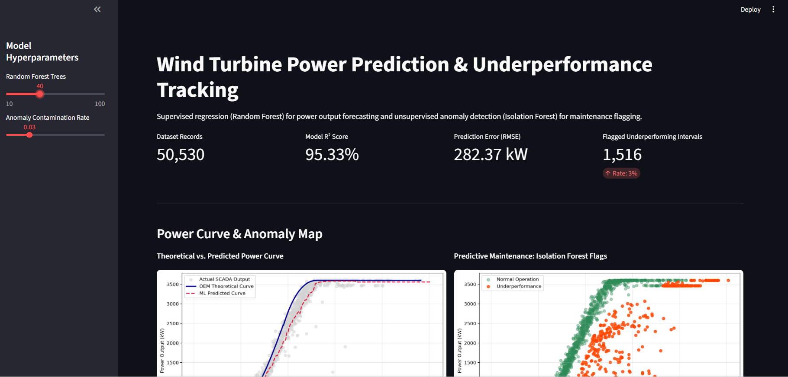

# Wind Turbine Power Prediction & Underperformance Tracking

A Streamlit dashboard that predicts a wind turbine's power output from SCADA data and flags unusual operating intervals for maintenance review.



## What it does

- **Power prediction (supervised):** a Random Forest regressor predicts active power (kW) from wind speed, wind direction, hour and month.
- **Underperformance flagging (unsupervised):** an Isolation Forest flags the most unusual intervals based on wind speed, actual power, and the gap between actual and theoretical power.
- **Interactive dashboard:** adjust model parameters in the sidebar, compare the OEM theoretical power curve with the learned curve, and run live predictions.

## Results (on the 2018 dataset, 50,530 records)

| Metric | Value |
|---|---|
| R² (random 80/20 split) | ~95% |
| RMSE | ~282 kW |

## Dataset

2018 SCADA data from a wind turbine in Turkey (10-minute intervals), available on Kaggle: **Wind Turbine Scada Dataset** by Berk Erisen.

The CSV is not included in this repo. Download `T1.csv` from Kaggle and place it next to `app.py`.

## Run locally

```bash
pip install -r requirements.txt
python -m streamlit run app.py
```

Then open http://localhost:8501.

## Limitations

- Data comes from a single turbine over one year.
- The train/test split is random. For time-series data, neighbouring readings are very similar, so R² is optimistic. A chronological split would be a fairer test.
- The Isolation Forest flags a fixed percentage (the contamination rate) of points, so the number of flagged intervals reflects that setting, not confirmed faults.
- The model does not learn turbine cut-out behaviour at very high wind speeds.

## Possible improvements

- Chronological train/test split and cross-validation.
- Add rolling-window features and compare against gradient boosting.
- Validate flagged intervals against maintenance logs, if available.

## Tech stack

Python, pandas, NumPy, scikit-learn, Streamlit, Matplotlib
